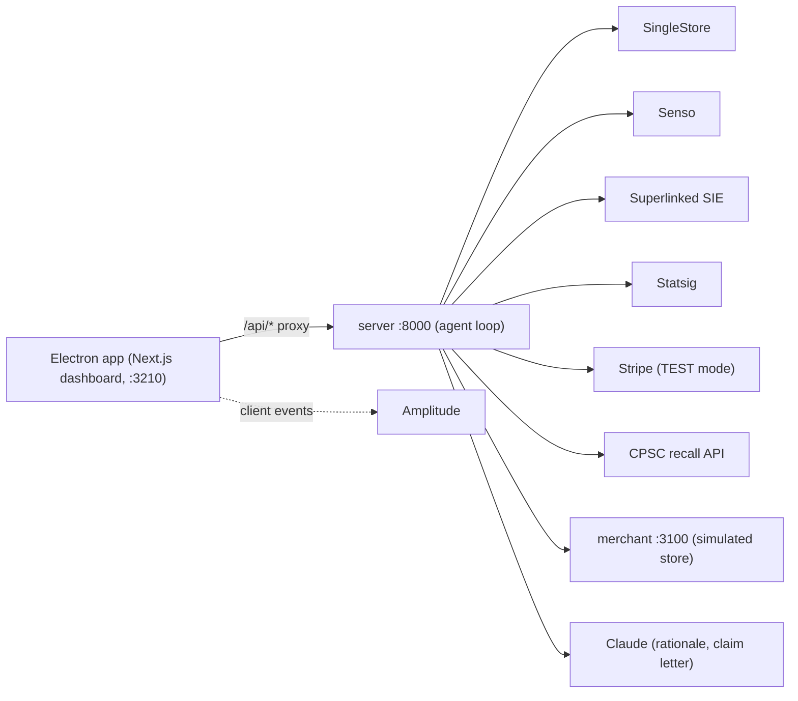

# SafeCart

> Every shopping agent finds you a deal. Ours checks it's safe first, and keeps protecting what you already own.

SafeCart is a personal shopping agent with an audit trail, built for the Personal Agents Hackathon (2026-11-20, prompt: "Build a shopping agent with an audit trail").

## Build status

| Part | Status |
|---|---|
| `web/` Electron + Next.js dashboard, recall alerts, demo bar, Amplitude client | On main |
| `server/` agent backend on :8000 | On main; golden path passes 2/2 rounds from the app |
| `merchant/` sandbox store on :3100 | On main |
| `data/` seed data and two real CPSC recalls (10014, 10328) | On main |
| `server/integrations/` sponsor clients (SingleStore, Senso, SIE, Statsig, Stripe) | On main. Each is used when its key is set; without it the trail labels the fallback |
| Claude (decision rationale + refund-claim letter, never decides) | On main (`server/src/llm.ts`); template text without `ANTHROPIC_API_KEY` |
| Firedrill evals | Scaffold in `evals/`, not run. No results |
| Persona step-up before purchases over the auto-buy limit | On main (`server/src/adapters/persona.ts`); live with `PERSONA_API_KEY` + `PERSONA_TEMPLATE_ID`, otherwise a labelled SIMULATED check you pass or fail from the approval card |
| Cognee, Airbyte | Not built |

## Problem

Shopping agents and price trackers stop at "here is a deal" or at checkout. None of them asks whether the product is safe before buying, and none watches what you already own. Recalls are published by the government, but owners rarely hear about them, and filing the remedy claim is tedious.

<!-- TODO: add a sourced statistic on recall response rates here, with the link. Do not use an unsourced number. -->

## User

Maya Chen, a new parent in Oakland. She is fictional, seeded for the demo.

- Preferences: auto-buy up to $150, avoids one brand, prefers lightweight, needs something that fits a narrow car.
- Wishlist (4): a stroller (under a real CPSC recall), a baby monitor, a white-noise machine, a bottle warmer.
- Owned (6, from order emails): includes a nursery item that is under a real CPSC recall.

## What it does

- **Memory:** keeps Maya's preferences, wishlist and owned items.
- **Wishlist sale auto-buy:** watches wishlist prices. When an item is on sale (price at or under target, or discount at or above the minimum) and under her auto-buy limit, it buys. Over the limit, it asks for approval and names the rule.
- **Recall check before every buy:** every purchase, including replacements, is checked against recall data first. Result is `clear`, `recalled` or `unknown`. It never auto-buys on `unknown`. A recalled sale item is skipped and the next fitting alternative is bought.
- **Owned-items recall sweep:** when a recall is published that matches something Maya owns, it files a refund claim at the store and buys a safe replacement that fits her preferences.
- **Audit trail:** every step, skip, claim and purchase is listed with its reason and cited sources. Runs show which claims are trusted (CPSC, Senso) and which come from untrusted listing text.
- **Injection guard:** listing text is untrusted; hidden instructions in it are flagged and dropped.

## Where Maya's data comes from

**Today:** Maya's preferences, wishlist and owned items come from seed files (`data/user.json`, `data/wishlist.json`, `data/owned.json`; the owned items match the demo order emails in `data/inbox/`). Purchases are the agent's own. In the chat you can add store items to the wishlist ("add a car seat to my wishlist", "watch a baby monitor under $70").

**Planned, not built: screen-aware memory.** SafeCart is meant to run as a desktop companion that, with the user's permission, reads what is on screen while they shop: items they add to a wishlist or cart on any store, order confirmations (what they bought), and products they look at often. It would store these in the agent's memory and show them on the dashboard, so the wishlist and owned items fill themselves instead of being typed in. Nothing in the current app captures or reads the screen.

## Architecture



Rendered: docs/architecture.svg (editable: docs/architecture.excalidraw)

With `AGENT_BACKEND_URL` unset, the web app's API routes answer from a built-in mock instead of :8000.

## One tick

The agent loop runs these steps in order. Each is an audit-trail step and a SingleStore ledger row.

1. Read the policy (Statsig dynamic config `purchase_policy` and gate `recall_guard`; defaults if Statsig is down).
2. Owned-items sweep: for a newly published recall, match owned items by model, UPC or name, raise an alert, file the refund claim at the store, find a replacement.
3. Wishlist watch: read each wishlist item's store price; on sale when price is at or under target or the discount is at or above the minimum.
4. Read the listing as untrusted: SIE guard on the raw text, then SIE extract of brand, model, price and UPC.
5. Safety check: SingleStore recalls table, live CPSC query, Senso recall notices, Senso fact-check "the <brand> <model> has no active recall".
6. If recalled: alert, skip, search alternatives (same category, under target, no recalled models, no avoided brands), rerank by preferences, check the top pick.
7. Decide: under the auto-buy limit, autonomy on and safety clear means buy; otherwise raise an approval naming the rule.
8. Buy: Stripe TEST PaymentIntent, store order, receipt with the safety check, full run in the trail.
9. With the `recall_guard` gate off, steps 5 and 6 are skipped and the trail is labelled NAIVE (used for the demo contrast).

## Sponsors

| Sponsor | Job in SafeCart | File |
|---|---|---|
| SingleStore | Catalog, price history, wishlist, owned items, recalls table, ledger; alternative search | `server/integrations/singlestore.ts` |
| Senso | Trusted knowledge base of recall notices and store policy; fact-check gate before every buy | `server/integrations/senso.ts`, `server/integrations/senso-gate.ts` |
| Superlinked SIE | Guard and extract on untrusted listings; rerank alternatives by preferences | `server/integrations/sie.ts` |
| Statsig | Dynamic config `purchase_policy` and gate `recall_guard`, flipped live in the demo | `server/integrations/statsig.ts` |
| Amplitude | Browser events for agent outcomes (sale_detected, safety_check, purchase_auto, recall_alert, approvals, policy_seen) | `web/src/lib/analytics.ts` (in the repo; no-op without a key) |
| Firedrill | Naive vs SafeCart simulation | `evals/` (scaffold, not run; no results) |
| Persona | Identity check before any approved purchase over the auto-buy limit; the trail keeps only the inquiry id | `server/src/adapters/persona.ts` |
| Stripe (not a sponsor) | Test-mode payment as the real action | `server/integrations/stripe.ts` |
| Claude (not a sponsor) | Writes the decision rationale and the refund-claim letter; buy/skip stays deterministic | `server/src/llm.ts` |

Cognee and Airbyte were planned and not built.

## Real vs simulated

| Real | Simulated |
|---|---|
| CPSC recall data (saferproducts.gov API) | The store (`merchant/`) |
| Senso, SIE, SingleStore, Statsig, Amplitude | Maya and her order inbox |
| Stripe payments in TEST mode (no money moves) | Refund claims (filed at the simulated store) |

The dashboard footer says the same. The mock agent used when no backend is connected is simulated end to end.

## Run locally

Requires Node 20.9+ (tested on Node 24).

**Desktop app (the way to run and present the demo):**

```bash
cd web
npm install
npm run build
npm run desktop    # opens the Electron app; its own server on port 3210 (DESKTOP_PORT to change)
```

The window opens maximized with the full dashboard. Keep it maximized: un-maximizing turns it into a chat-only widget. See [Desktop app](#desktop-app).

**Development (`npm run dev`, development only):**

```bash
cd web
npm install
npm run dev
```

Open http://localhost:3000 and use the same steps as the desktop app. Turn on **Autopilot**. The mock buys Maya's wishlist items; the stroller mission takes the recall branch (alert, purchase skipped, alternative bought). **Check now** runs a check immediately.

**With the real backend:** copy `web/.env.example` to `web/.env.local` and set:

```bash
AGENT_BACKEND_URL=http://localhost:8000   # unset = built-in mock; no trailing slash
NEXT_PUBLIC_AMPLITUDE_API_KEY=            # optional; empty = analytics off
```

Restart the app after changing it (rebuild first if a `NEXT_PUBLIC_*` value changed). Backend env vars live in a gitignored repo-root `.env` (names only here):

`S2_URL`, `SENSO_API_KEY`, `SIE_API_KEY`, `STATSIG_SERVER_KEY`, `STRIPE_SECRET_KEY` (`sk_test_` only), `ANTHROPIC_API_KEY`, `MERCHANT_URL`, `PERSONA_API_KEY` + `PERSONA_TEMPLATE_ID` (sandbox). P1: `LLM_API_KEY`, `AIRBYTE_CLIENT_ID`, `AIRBYTE_CLIENT_SECRET`.

Start the backend first:

```bash
cd server/integrations && npm install && cd .. && npm install && npm run dev   # :8000, GET /health lists keys and fallbacks
cd merchant && npm start                                                     # :3100
```

Ports: app :3210 (desktop) or web :3000 (dev), server :8000, merchant :3100.

**Demo controls** (demo bar in the **Logs** tab; results show in the **Shop** tab; `showDemoControls` in `web/src/config/app.config.ts`): "Put stroller on sale -30%", "Publish recall", "Plant injected listing", "Big purchase ($199, needs Persona)", "Reset demo". It also shows the current policy (auto-buy limit, autonomy, recall guard and its source). Sku and recall id come from `appConfig.demo` and must match the backend seed.

### Troubleshooting

- `npm install` fails with `EALLOWSCRIPTS`: your `~/.npmrc` contains an `allow-scripts=` line, which npm 11.19+ rejects. Remove that line, or run npm with an empty user config, for example `NPM_CONFIG_USERCONFIG=/path/to/empty.npmrc npm install`.

## Backend contract

The Next.js routes validate requests and forward to `AGENT_BACKEND_URL`. The backend implements:

| Method and path | Purpose |
|---|---|
| `POST /tick` | One proactive check. Body `TickRequest`: `{"tick", "missions": [{"id","title","maxPrice","currency"}], "guardrails": {"autoBuyLimit","dailyBudget"}, "spentToday"}`. Response: NDJSON, one event per line, ending with exactly one `done` or `error` |
| `POST /action` | Execute a purchase the user approved. Body `{"candidateId","query"}`. Response `ActionResult` JSON; the safety check runs first |
| `POST /chat` | Chat. Body `{"message","context"}`, response `{"reply","actions"}` |
| `GET /profile` | Maya's `Profile`: preferences, wishlist, owned items, policy |
| `POST /demo/sale`, `/demo/recall`, `/demo/reset` | Demo controls |

Events: `step`, `mission`, `approval`, `receipt` (with `safety`), `recall`, `run`, `done`, `error`. Steps upsert by id (send `running`, then `ok` or `fail`); recall alerts upsert by `alert.id`. Types: `web/src/lib/agent/types.ts`. If the backend is unreachable, the routes return `502 {"error":"Agent backend unreachable"}`.

```bash
curl -N -X POST http://localhost:3000/api/agent/tick -H 'content-type: application/json' \
  -d '{"tick":1,"missions":[{"id":"m1","title":"Charger","maxPrice":40,"currency":"USD"}],"guardrails":{"autoBuyLimit":50,"dailyBudget":300},"spentToday":0}'
```

## Demo script (3 minutes)

| Time | Beat |
|---|---|
| 0:00 | Hook: every shopping agent finds a deal, none checks recalls. Show Maya's memory panel: preferences, wishlist, owned items. |
| 0:20 | Click "Publish recall". Next tick: a real CPSC recall hits an item Maya owns; the agent files the refund claim and buys a safe replacement. Open the run to show the CPSC and Senso citations. |
| 1:00 | Click "Put stroller on sale -30%". The agent sees the sale, finds the stroller recalled, skips it and buys the next choice. The trail shows the rejected option and why. |
| 1:35 | Turn the Statsig gate `recall_guard` off (naive agent) and repeat the sale: it buys the recalled stroller and the receipt is labelled NAIVE. Turn it back on. |
| 2:05 | Show an injected listing blocked by the SIE guard. |
| 2:20 | Amplitude funnel (sale, safety check, purchase). Firedrill pass rates only if the run was done; otherwise skip. |
| 2:40 | Architecture and sponsors, close. |

## Desktop app

```bash
cd web
npm run build      # optional: the desktop app uses the production build when one exists, otherwise next dev
npm run desktop    # opens the Electron app (its own server on port 3210; DESKTOP_PORT to change)
```

Maximized, it shows the full dashboard with the chat docked on the right. Un-maximized, it becomes a 420x720 always-on-top widget with the chat and the Autopilot switch (layout switches below 720 px width). `DESKTOP_URL=http://localhost:3000 npm run desktop` wraps a running server. Not packaged as an installer.

## Chat

Talk to the agent in the chat panel: "add a car seat to my wishlist", "watch a baby monitor under $70", "pause", "resume", "approve", "decline", "check now", "what did you buy?", "why?", "status". With `AGENT_BACKEND_URL` set, chat is forwarded to `<url>/chat`, where "add/watch <item> [under $N]" finds the item in the store and adds it to the wishlist (target: your price, or the minimum discount off list); it lasts until **Reset demo**. Otherwise a rule-based mock answers (`web/src/lib/agent/chat-mock.ts`).

## Checks

Run from `web/`:

```bash
npm run lint
npm run build
npm run check:agent   # reducer self-check
npm run smoke         # HTTP smoke checks; needs a running server (default http://localhost:3000)
```

## Customize

| Change | Edit |
|---|---|
| Name, tagline, footer, missions, guardrails, sponsors strip, demo ids | `web/src/config/app.config.ts` |
| Mock scenario and Maya's profile | `web/src/lib/agent/mock.ts`, `web/src/lib/agent/profile-mock.ts` |
| Dashboard layout and panels | `web/src/components/dashboard.tsx` and `web/src/components/<panel>.tsx` |
| Autopilot timing, approve and decline | `web/src/hooks/use-autopilot.ts` |
| Event types (additive changes only) | `web/src/lib/agent/types.ts` |

## Limits

- Without `AGENT_BACKEND_URL`, all data in the dashboard is mock. Without sponsor keys, the backend uses labelled fallbacks.
- The store, shopper and inbox are simulated; refund claims go to the simulated store, not a real merchant.
- Payments are Stripe TEST mode only. No real money moves.
- Autopilot runs in the app window: it checks only while the dashboard is open, and state resets on reload (only the on/off switch is saved).
- The safety check covers CPSC recalls only (plus the Senso knowledge base). Other regulators and recall sources are not covered.
- No auth. Not deployed.

## Team

Nael (web dashboard, Amplitude, evals, submission), jusman (agent backend, merchant sandbox, seed data), Hong Zhe (sponsor clients, keys).
